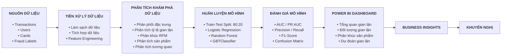

# Đánh giá rủi ro gian lận trong giao dịch ngân hàng

[English](README_en.md) | **Tiếng Việt**

---

## 1. Bối cảnh kinh doanh

Không khó để bắt gặp trên báo chí và truyền hình những câu chuyện về các vụ lừa đảo chuyển tiền hoặc kẻ gian sử dụng thông tin thẻ của người khác để thực hiện giao dịch trái phép. Chỉ trong vài thao tác, tiền có thể bị chuyển đi mà chủ tài khoản không hề hay biết và việc thu hồi không phải lúc nào cũng dễ dàng.

Khi phát hiện tiền trong tài khoản bị mất, khách hàng thường tìm đến ngân hàng để nhờ hỗ trợ. Tuy nhiên, không phải trường hợp nào ngân hàng cũng có thể giúp khách hàng thu hồi số tiền đã mất. Những sự việc như vậy không chỉ gây thiệt hại về tài sản mà còn ảnh hưởng đến niềm tin của khách hàng vào sự an toàn khi gửi tiền và sử dụng dịch vụ ngân hàng.

Trước thực trạng đó, trong một buổi trao đổi về tình hình gian lận tại ngân hàng, **Giám đốc Quản trị rủi ro (CRO)** đã chia sẻ những vấn đề ngân hàng đang gặp phải và giao cho tôi — một **Risk Analyst** — nhiệm vụ tìm hiểu sâu hơn về thực trạng gian lận:

> **Dạo này ngân hàng thường xuyên tiếp nhận khách hàng đến yêu cầu hỗ trợ xử lý các sự cố liên quan đến giao dịch. Có người cần khóa thẻ bị thất lạc, có người yêu cầu tra soát giao dịch chuyển khoản nhầm, cũng có trường hợp bị lộ thông tin đăng nhập ứng dụng ngân hàng. Phần lớn số tiền bị mất không thể thu hồi và vụ việc phải chuyển cho cơ quan chức năng xử lý. Mỗi vụ như vậy đều gây hoảng loạn, ảnh hưởng đến uy tín và làm giảm niềm tin của khách hàng vào sự an toàn tại ngân hàng. Vì vậy, em giúp anh xây dựng dashboard trực quan thực trạng gian lận hiện nay và xác định gian lận đang tập trung ở phân khúc nào để anh nắm rõ tình hình trước đã nhé.**

Từ yêu cầu của Giám đốc Quản trị rủi ro, tôi chia thành các mục tiêu sau:

1. Đánh giá quy mô và xu hướng gian lận theo thời gian và địa điểm giao dịch
2. Xác định đặc điểm và hành vi khách hàng có liên quan đến gian lận để ưu tiên giám sát
3. Xác định sản phẩm, phương thức và kênh giao dịch có mức độ gian lận đáng chú ý
4. Đánh giá khả năng dự báo giao dịch gian lận từ các tín hiệu rủi ro và lựa chọn mô hình phù hợp để dự báo

---

## 2. Đầu ra kỳ vọng

Để đáp ứng yêu cầu của Giám đốc Quản trị rủi ro, báo cáo được thiết kế thành hệ thống gồm 4 Dashboard liên kết theo luồng phân tích từ nhận diện thực trạng đến giải pháp khuyến nghị:

| STT | Dashboard | Nội dung trình bày | Ý nghĩa |
| :---: | :--- | :--- | :--- |
| **01** | **Fraud Overview** (Tổng quan gian lận) | Trực quan hóa bức tranh tổng thể về quy mô, xu hướng gian lận theo thời gian, địa điểm và đặc điểm giao dịch | Nắm bắt tình hình gian lận, xác định thời điểm và khu vực có rủi ro đáng chú ý để định hướng giám sát|
| **02** | **Fraud – Affected Customers** (Khách hàng bị ảnh hưởng bởi gian lận) | Phân tích tỷ lệ gian lận theo phân khúc RFM, độ tuổi và mức thu nhập của khách hàng | Nhận diện những nhóm khách hàng có tỷ lệ gian lận cao hơn mặt bằng chung để ưu tiên theo dõi và xây dựng biện pháp bảo vệ phù hợp |
| **03** | **Fraud Rate by Banking Products** (Rủi ro theo sản phẩm và kênh giao dịch) | So sánh mức độ gian lận theo loại thẻ, thương hiệu thẻ, phương thức giao dịch và đặc điểm sử dụng thẻ | Xác định các sản phẩm, phương thức và kênh giao dịch có rủi ro đáng chú ý để xem xét tăng cường kiểm soát phù hợp |
| **04** | **Fraud Prediction Result** (Kết quả dự đoán gian lận) | Đánh giá và so sánh hiệu quả nhận diện giao dịch gian lận của các mô hình học máy | Có cơ sở lựa chọn mô hình tiềm năng để tiếp tục đánh giá và phát triển giải pháp hỗ trợ phát hiện gian lận|
---

## 3. Dữ liệu

### 3.1. Quy mô dữ liệu

| Chỉ tiêu | Quy mô |
| --- | ---: |
| Số lượng giao dịch | 8,914,963 |
| Hồ sơ khách hàng | 2,000 |
| Hồ sơ thẻ | 6,146 |
| Tỷ lệ giao dịch gian lận | 0.15% |
| Giai đoạn quan sát | 2010–2019 |

### 3.2. Các bảng dữ liệu và đặc trưng chính

#### `transactions_data.csv` — Dữ liệu giao dịch 

| Cột | Mô tả |
| --- | --- |
| `id` | Mã giao dịch |
| `date` | Thời gian giao dịch |
| `client_id` | Mã khách hàng |
| `card_id` | Mã thẻ |
| `amount` | Giá trị giao dịch (USD) |
| `use_chip` | Giao dịch có sử dụng xác thực bằng chip hay không |
| `merchant_id` | Mã đơn vị bán hàng |
| `merchant_city` | Địa điểm của đơn vị bán hàng (thành phố) |
| `merchant_state` | Địa điểm của đơn vị bán hàng (bang) |
| `zip` | Mã ZIP của đơn vị bán hàng |
| `mcc` | Merchant Category Code (loại hình kinh doanh) |
| `errors` | Thông tin lỗi giao dịch |

#### `users_data.csv` — Dữ liệu khách hàng

| Cột | Mô tả |
| --- | --- |
| `client_id` | Mã khách hàng |
| `current_age` | Tuổi khách hàng |
| `retirement_age` | Độ tuổi nghỉ hưu dự kiến |
| `birth_year` | Năm sinh |
| `gender` | Giới tính |
| `latitude`, `longitude` | Vị trí khách hàng |
| `per_capita_income` | Thu nhập bình quân đầu người |
| `yearly_income` | Thu nhập hàng năm |
| `total_debt` | Tổng dư nợ |
| `credit_score` | Điểm tín dụng |
| `num_credit_cards` | Số lượng thẻ tín dụng sở hữu |

#### `cards_data.csv` — Dữ liệu thẻ

| Cột | Mô tả |
| --- | --- |
| `id` | Mã thẻ |
| `client_id` | Mã khách hàng |
| `card_brand` | Thương hiệu thẻ (Visa, Mastercard,...) |
| `card_type` | Loại thẻ (Credit, Debit) |
| `has_chip` | Thẻ có công nghệ chip hay không |
| `credit_limit` | Hạn mức tín dụng |
| `acct_open_date` | Ngày mở tài khoản |
| `year_pin_last_changed` | Năm thay đổi PIN gần nhất |
| `card_on_dark_web` | Thông tin thẻ có bị phát tán trên dark web hay không |

#### `train_fraud_labels.json` — Nhãn gian lận

| Cột | Mô tả |
| --- | --- |
| `id` | Mã giao dịch |
| `is_Fraud` | Nhãn gian lận (True/False, khoảng 0.15% positive) |

---

## 4. Quy trình thực hiện dự án

### 4.1. Chuẩn bị và xử lý dữ liệu

- Kiểm tra cấu trúc, kiểu dữ liệu, giá trị thiếu và bản ghi trùng lặp.
- Chuẩn hóa giá trị giao dịch và các trường định dạng tiền tệ.
- Xử lý thông tin vị trí và lỗi giao dịch bị thiếu theo quy tắc của dự án.
- Kết hợp dữ liệu giao dịch với hồ sơ khách hàng, hồ sơ thẻ và nhãn gian lận.
- Xây dựng các biến về giờ, ngày, tháng, năm, nhóm tuổi, nhóm thu nhập, nhóm giá trị giao dịch và đặc điểm sản phẩm.

### 4.2. Khám phá dữ liệu

- **Quy mô hoạt động:** số lượng và giá trị giao dịch theo thời gian, khách hàng, sản phẩm và kênh.
- **Mức độ rủi ro:** tỷ lệ gian lận trong từng phân khúc.
- **Phân khúc khách hàng RFM:** điểm RFM được sử dụng để phân nhóm khách hàng theo ba tiêu chí về thời gian (Recency), tần suất (Frequency) và lượng tiền giao dịch (Monetary); các phân khúc gồm có: Champions, Loyal, New Customers, Potential Loyalists, Need Attention, Cannot Lose Them và Lost Customers.
- **Phân khúc dữ liệu giao dịch theo sản phẩm:** Chia nhóm lượng tiền giao dịch, số giao dịch, số khách hàng và tỷ lệ gian lận theo từng sản phẩm về các loại thẻ, hãng thẻ, phương thức giao dịch được sử dụng.
- **Phân tích tương quan:** xác định các biến ảnh hưởng để đưa vào mô hình dự báo rủi ro gian lận.

### 4.3. Xây dựng và đánh giá mô hình

Ba mô hình được lựa chọn để đại diện cho các mức độ phức tạp khác nhau:

- **Logistic Regression:** mô hình nền, dễ diễn giải.
- **Random Forest:** mô hình tập hợp cây, có khả năng mô hình hóa quan hệ phi tuyến.
- **GBTClassifier:** mô hình boosting, tối ưu tuần tự các cây quyết định để cải thiện khả năng phân loại.

Các mô hình được so sánh trên nhiều chỉ số để phản ánh đồng thời khả năng phân biệt, khả năng phát hiện gian lận và chi phí cảnh báo sai.

---

## 5. Trực quan hóa và phân tích thực trạng trên Power BI

### 5.1. Fraud Overview (Tổng quan gian lận)

Dữ liệu ghi nhận **8.91 triệu giao dịch**, **13,332 giao dịch gian lận**, tỷ lệ gian lận **0.15%** và tổng giá trị gian lận khoảng **$1.47 triệu** trong giai đoạn 2010–2019.

- **Xu hướng chuỗi thời gian (2010–2019):**
  - Số lượng giao dịch tăng trưởng đều trong giai đoạn 2010–2015 và bắt đầu đi vào quỹ đạo ổn định từ 2016 trở đi, cho thấy quy mô tệp khách hàng của ngân hàng đã qua giai đoạn mở rộng nhanh và đạt độ bão hòa.
  - Tỷ lệ gian lận (*Fraud Rate*) biến động mạnh và lập đỉnh vào năm **2016 (0.53%)**. Xu hướng rủi ro cho thấy chu kỳ biến động khoảng 2 năm/lần: sau các đợt bùng nổ tấn công gian lận quy mô lớn, tỷ lệ rủi ro hạ nhiệt ở năm kế tiếp khi người dùng nâng cao cảnh giác, nhưng sau đó lại có xu hướng tăng trở lại khi kẻ gian thay đổi thủ đoạn tinh vi hơn.
- **Phân bổ theo giá trị giao dịch:**
  - Tỷ lệ gian lận tăng đột biến ở các giao dịch có giá trị lớn, đặc biệt từ **$2,000 trở lên (12.79%)**, dù số lượng các giao dịch này chiếm tỷ trọng nhỏ. Điều này đồng nghĩa với việc thiệt hại tài chính trên mỗi vụ gian lận là rất lớn.
- **Phân bố địa lý (Merchant Location):**
  - Gian lận tập trung phần lớn tại khu vực **Bắc Mỹ** (đặc biệt là các bang ven biển phía Đông Nam) và rải rác một số khu vực thương mại lớn tại **Châu Âu**. Đây là những thị trường phát triển, có mật độ giao dịch thẻ và thanh toán kỹ thuật số dày đặc, khiến mức độ phơi nhiễm rủi ro cao hơn.
- **Ma trận thời gian:**
  - Rủi ro gian lận phân bổ mạnh vào khung giờ ban ngày **09:00 – 16:00, đặc biệt tăng cao đột biến vào Chủ Nhật**. Bên cạnh đó, biểu đồ nhiệt cũng ghi nhận các điểm rủi ro xuất hiện vào khung giờ đêm muộn đến sáng sớm (**03:00 – 05:00**).
  - *Giả thiết lý giải hành vi:* Các giao dịch gian lận tập trung vào ban ngày có thể xuất phát từ việc kẻ gian lợi dụng lúc khách hàng bận rộn để tạo áp lực, yêu cầu chuyển tiền gấp hoặc giả danh cơ quan chức năng nhằm khiến nạn nhân mất cảnh giác; trong khi đó, vào đêm muộn và sáng sớm, khách hàng dễ mất cảnh giác, chậm nhận ra dấu hiệu lừa đảo. Riêng cuối tuần, việc vui chơi, mua sắm có thể làm tăng nguy cơ thất lạc thẻ hoặc sơ suất khi giao dịch.

---

### 5.2. Fraud - Affected Customers (Nhóm khách hàng bị ảnh hưởng bởi hành vi gian lận)

Dữ liệu gồm **1,219 khách hàng có hoạt động trên tổng số 2,000 khách hàng**, đồng thời đối chiếu quy mô giao dịch và tỷ lệ gian lận theo phân khúc RFM, nhóm tuổi, thời điểm và giá trị giao dịch.

- **Phân khúc RFM:** Tệp khách hàng được chia làm 4 nhóm chính: **nhóm khách hàng tiềm năng** (New Customers, Potential Loyalist, Promising) chiếm 42.49% số khách hàng hoạt động, tiếp theo là **nhóm VIP** (Champions, Loyal) với 32.81%, **nhóm có nguy cơ rời bỏ** (Cannot Lose Them, Lost Customers, Need Attention) với 16.65% và các **nhóm còn lại** (Others) với 8.04%. Trong đó:

  - **New Customers (Khách hàng mới):** Ghi nhận tỷ lệ gian lận cao nhất toàn hệ thống (**0.31%**, gấp 3 lần khách hàng Champions). Nguyên nhân có thể đến từ rủi ro kẻ gian dùng giấy tờ giả mạo mở thẻ để trục lợi và việc người dùng mới chưa hình thành thói quen bảo mật thông tin thẻ/tài khoản.

  - **Lost Customers (Khách hàng rời bỏ):** Có tỷ lệ gian lận cao thứ hai (**0.24%**). Một tỷ lệ lớn khách hàng rời bỏ dịch vụ có thể xuất phát từ việc họ từng là nạn nhân của các vụ lừa đảo gian lận tài chính, dẫn đến việc họ mất niềm tin vào tính an toàn của ngân hàng.

- **Nhóm tuổi:**
  - Nhóm khách hàng từ **56 tuổi trở lên** chiếm tới hơn **40%** lượng khách hàng hoạt động và có tỷ lệ gian lận lên tới **0.17%** (cao nhất trong các nhóm tuổi). Đây là nhóm khách hàng cốt lõi nhưng lại là mục tiêu hàng đầu của các chiêu trò tấn công lừa đảo do hạn chế hơn về kỹ năng nhận diện thủ đoạn công nghệ.

- **Mức thu nhập hàng năm (Yearly Income):**
  - Nhóm có thu nhập rất thấp (**$100 – $1,000**) ghi nhận tỷ lệ rủi ro đột biến (**0.63%**, gấp 4-5 lần mức bình quân). Đây phần lớn là nhóm học sinh, sinh viên, người chưa có việc làm ổn định, có thể có ít kinh nghiệm sử dụng dịch vụ tài chính nên dễ trở thành đối tượng bị lừa đảo.

---

### 5.3. Fraud Rate by Banking Products (Rủi ro theo Sản phẩm & Kênh Giao dịch)

Dữ liệu bao gồm **4,070 thẻ hoạt động trên tổng số 6,146 thẻ** và mức độ rủi ro theo loại thẻ, thương hiệu thẻ, phương thức giao dịch và số lượng thẻ khách hàng sở hữu.

- **Trung bình số thẻ sở hữu của từng khách hàng:**
  - Tỷ lệ thẻ bình quân ghi nhận **3.34 thẻ/khách hàng hoạt động**. Tuy nhiên, phân tích sâu về cơ cấu giao dịch cho thấy có sự chênh lệch: hơn **99%** khách hàng chỉ thường xuyên sử dụng 1–2 thẻ, nhóm khách hàng giao dịch từ 3 thẻ trở lên chỉ chiếm **0.88%** nhưng lại có tỷ lệ gian lận cao nhất (**0.19%**). Điều này phản ánh việc sở hữu dàn trải quá nhiều thẻ làm tăng nguy cơ thất lạc thông tin thẻ hoặc lơ là trong việc giám sát biến động số dư.
- **Loại thẻ (Card Type):**
  - Thẻ **Debit (Prepaid)** chiếm tỷ trọng giao dịch nhỏ nhất (khoảng 8.87%) nhưng lại có tỷ lệ gian lận cao nhất danh mục (**0.22%**). Do thẻ trả trước không liên kết trực tiếp với tài khoản ngân hàng và thường có quy trình định danh lỏng lẻo hơn, tạo cơ hội cho kẻ gian lợi dụng lỗ hổng bảo mật để thay đổi số dư hoặc hạn mức rút tiền. Bên cạnh đó, việc thiếu thông tin định danh và dữ liệu lịch sử giao dịch có thể gây khó khăn cho quá trình giám sát, nhận diện các hành vi bất thường.
- **Hãng thẻ (Card Brand):**
  - **Discover** chiếm thị phần giao dịch rất nhỏ (chưa tới 3%) nhưng lại có tỷ lệ gian lận cao nhất (**0.21%**), vượt qua Visa và Mastercard (đều ở mức 0.15%). Điều này cho thấy hệ thống bảo mật và cơ chế chống gian lận ở các mạng lưới thanh toán nhỏ hơn có thể chưa được đầu tư tối ưu bằng các hãng thẻ toàn cầu.
- **Phương thức giao dịch (Transaction Channel):**
  - Giao dịch Online có tỷ lệ gian lận cao nhất, đạt **0,84%**, gấp 8 lần Chip **(0,10%)** và 28 lần Swipe **(0,03%)**, dù chỉ chiếm khoảng **11,7%** tổng số giao dịch. Kênh Online có thể bị lợi dụng khi thông tin giao dịch bị đánh cắp qua website giả mạo, các thủ đoạn lừa đảo hoặc rò rỉ dữ liệu, tạo điều kiện cho kẻ gian thực hiện giao dịch trái phép từ xa.

---

## 6. Kết quả mô hình dự báo gian lận

Phần phân tích thực trạng giúp xác định **fraud xảy ra ở đâu và những đặc điểm nào có liên quan**. Bước tiếp theo là kiểm tra:

> **Các đặc điểm này có đủ khả năng phân biệt giao dịch fraud và non-fraud để tạo tín hiệu đánh giá rủi ro hay không?**

Quy trình xử lý dữ liệu, feature engineering, huấn luyện và đánh giá mô hình được thực hiện trong notebook [`banking_transaction_analytics.ipynb`](banking_transaction_analytics.ipynb). Trang Fraud Prediction Result trong Power BI tổng hợp các kết quả từ notebook thành góc nhìn quản trị, tập trung vào khả năng phát hiện đúng gian lận và số trường hợp gian lận bị bỏ sót.

### So sánh hiệu suất

| Mô hình | ROC-AUC | PR-AUC | Accuracy | Precision | Recall | F1-score |
| --- | ---: | ---: | ---: | ---: | ---: | ---: |
| Logistic Regression | 0.8444 | 0.0213 | 99.85% | 28.97% | 0.29% | 0.58% |
| Random Forest | 0.8934 | 0.0927 | 99.85% | **98.91%** | 2.56% | 5.00% |
| **GBTClassifier** | **0.9427** | **0.2748** | **99.87%** | 94.54% | **11.42%** | **20.38%** |

### Khả năng phát hiện gian lận

| Mô hình | Gian lận phát hiện đúng (TP) | Gian lận bỏ sót (FN) | Cảnh báo sai (FP) | Tổng số giao dịch gian lận trong tập đánh giá |
| --- | ---: | ---: | ---: | ---: |
| Logistic Regression | 31 | 10,581 | 76 | 10,612 |
| Random Forest | 272 | 10,340 | **3** | 10,612 |
| **GBTClassifier** | **1,212** | **9,400** | 70 | 10,612 |

**GBTClassifier là mô hình ứng viên tốt nhất trong phạm vi dự án** vì có ROC-AUC và PR-AUC cao nhất, đồng thời phát hiện nhiều fraud nhất tại ngưỡng mặc định.

Tuy nhiên, Recall **11.42%** cho thấy mô hình vẫn bỏ sót phần lớn fraud. Vì vậy, mô hình phù hợp hơn với vai trò tạo **tín hiệu cảnh báo** hơn là tín hiệu chặn giao dịch.

---

## 7. Đề xuất dựa trên dữ liệu

### Kiểm soát các giao dịch bất thường

- Yêu cầu xác minh thêm cho các giao dịch có giá trị lớn bất thường so với lịch sử của khách hàng.
- Tăng cường giám sát vào những khung giờ và ngày có dấu hiệu rủi ro, đồng thời theo dõi tần suất giao dịch và biến động số dư để phát hiện hành vi bất thường.
- Tăng cường xác minh khi các giao dịch phát sinh tại địa điểm khác biệt so với thói quen thường ngày của khách hàng.

### Tăng cường bảo vệ khách hàng

- Cải thiện các hình thức xác minh định danh khách hàng mới đăng ký dịch vụ để hạn chế giả mạo, đồng thời hướng dẫn khách mới cách sử dụng và bảo mật tài khoản. 
- Thường xuyên gửi tin nhắn cập nhật các thủ đoạn lừa đảo mới, đặc biệt đến khách hàng lớn tuổi.

### Tăng cường giám sát theo sản phẩm và kênh giao dịch

- Bổ sung bước xác thực đối với các giao dịch Online có dấu hiệu đáng ngờ.
- Rà soát các giao dịch sử dụng thẻ Debit (Prepaid) và Discover để xác định những điểm còn hạn chế trong quy trình bảo mật, từ đó bổ sung các biện pháp bảo vệ hoặc thêm các bước xác minh khách hàng.
- Khuyến khích khách hàng khóa các thẻ ít sử dụng hoặc không còn nhu cầu sử dụng để hạn chế nguy cơ bị đánh cắp thông tin và phát sinh giao dịch trái phép.

### Ứng dụng học máy trong dự báo gian lận

- Có thể tận dụng mô hình học máy để hỗ trợ phát hiện và cảnh báo sớm các giao dịch đáng ngờ. Khi có thêm dữ liệu và cải thiện cách huấn luyện, mô hình có thể được nâng cấp để nhận diện gian lận chính xác hơn và hỗ trợ ngân hàng chủ động hơn trong công tác kiểm soát rủi ro.

---
## 8. Giá trị cá nhân đạt được sau dự án

Nắm vững tư duy và quy trình triển khai một báo cáo từ đầu đến cuối theo trình tự:

- Biết cách xác định câu hỏi, mục tiêu, kết quả cần đạt và nguồn dữ liệu cần thiết để giải quyết một vấn đề kinh doanh.
- Sử dụng PySpark trên Databricks để xử lý dữ liệu lớn với gần 10 triệu bản ghi; thực hiện xây dựng, đánh giá và so sánh các mô hình Machine Learning cho bài toán dự đoán gian lận trên dữ liệu mất cân bằng.
- Kết nối và xử lý dữ liệu trên Power BI, xây dựng các chỉ số cần thiết (DAX Measures) và trực quan hóa dữ liệu để hỗ trợ việc phân tích, tìm ra các vấn đề và đưa ra nhận định từ báo cáo.
- Có thêm hiểu biết về nghiệp vụ ngân hàng, đặc biệt trong lĩnh vực quản trị rủi ro, qua đó hiểu rõ hơn cách một Risk Analyst tiếp cận dữ liệu và hỗ trợ công việc quản trị rủi ro hằng ngày.
