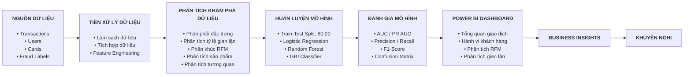

# Đánh giá rủi ro gian lận trong giao dịch ngân hàng

[English](README_en.md) | **Tiếng Việt**

---

## 1. Bối cảnh kinh doanh

Chuyển đổi số đang làm thay đổi cách ngân hàng cung cấp sản phẩm và thực hiện giao dịch. Khi quy mô khách hàng ngày càng lớn, các kênh giao dịch số ngày càng phổ biến và ngân hàng liên tục phát triển những sản phẩm, phương thức thanh toán mới nhằm tăng tính tiện lợi, tốc độ và bảo mật cho khách hàng.

Tuy nhiên, cùng với sự phát triển đó, **bề mặt rủi ro cũng thay đổi**. Một phương thức hoặc công nghệ mới có thể an toàn và hiệu quả hơn phương thức cũ nhưng vẫn có khả năng xuất hiện những điểm yếu mà các đối tượng gian lận có thể khai thác.

Thực tế trong quá trình hoạt động, đã có ghi nhận một số trường hợp gian lận xảy ra làm ảnh hưởng đến khách hàng và uy tín của ngân hàng. Bên cạnh đó, ngân hàng còn phải dành nguồn lực để điều tra, xử lý và khắc phục các sự cố phát sinh.

Điều này đặt ra hai yêu cầu cho hoạt động quản trị rủi ro:

- **Phát hiện được nơi gian lận thường xảy ra** để tập trung giám sát vào các nhóm giao dịch, khách hàng, sản phẩm hoặc kênh có tín hiệu rủi ro cao hơn.
- **Cải thiện khả năng dự báo** nếu phương pháp phân vùng và đánh giá rủi ro hiện tại chưa theo kịp sự thay đổi của hành vi giao dịch và công nghệ.

Trước thực trạng đó, **Giám đốc quản trị rủi ro (CRO)** cần tìm hiểu:

> **Thực trạng gian lận trong giao dịch ngân hàng hiện nay ra sao, gian lận đang tập trung ở đâu, những yếu tố nào có liên quan đến rủi ro gian lận, và liệu các tín hiệu này có thể được khai thác để chủ động đánh giá rủi ro của từng giao dịch hay không?**

Để trả lời câu hỏi của Giám đốc quản trị rủi ro, cần tập trung vào các mục tiêu sau:

1. Đánh giá quy mô và xu hướng gian lận theo thời gian, địa điểm và đặc điểm giao dịch
2. Xác định đặc điểm và hành vi khách hàng có liên quan đến gian lận để ưu tiên giám sát
3. Xác định sản phẩm, phương thức và kênh giao dịch có mức độ gian lận đáng chú ý
4. Đánh giá khả năng dự báo giao dịch gian lận từ các tín hiệu rủi ro và lựa chọn mô hình phù hợp để dự báo

Mục tiêu cuối cùng là chuyển từ:

> **Biết gian lận đã xảy ra ở đâu → biết nên ưu tiên giám sát ở đâu → đánh giá khả năng phát hiện rủi ro sớm hơn.**

---

## 2. Kết quả kỳ vọng

| Câu hỏi của CRO | Kết quả trình bày |
| --- | --- |
| **Fraud đang xảy ra như thế nào?** | Quy mô, tỷ lệ, xu hướng và các mẫu hình chính |
| **Fraud tập trung ở đâu?** | Rủi ro theo thời gian, địa điểm, khách hàng và giao dịch |
| **Nhóm nào cần chú ý hơn?** | Customer Behavior và RFM Segment |
| **Sản phẩm/kênh nào đáng chú ý?** | Product Analysis |
| **Có thể dự báo được rủi ro không?** | Kết quả dự báo của các mô hình ML |
| **Mô hình nào phù hợp hơn?** | So sánh khả năng phát hiện, cảnh báo sai và ứng dụng thực tế |

### Các trang trình bày Power BI

**01 — Fraud Overview**  
Trả lời: *Fraud đang xảy ra ở đâu và khi nào?*

**02 — Customer Behavior**  
Trả lời: *Đặc điểm và hành vi khách hàng nào đáng chú ý?*

**03 — RFM Segment**  
Trả lời: *Fraud exposure nằm trong nhóm khách hàng nào?*

**04 — Product Analysis**  
Trả lời: *Sản phẩm và phương thức giao dịch nào cần chú ý?*

**05 — Fraud Prediction Result**  
Trả lời: *Có thể dùng dữ liệu để tạo tín hiệu đánh giá rủi ro giao dịch hay không?*

---

## 3. Dữ liệu

### 3.1. Quy mô dữ liệu

| Chỉ tiêu | Quy mô |
| --- | ---: |
| Số lượng giao dịch | 8,914,963 |
| Hồ sơ khách hàng | 2,000 |
| Hồ sơ thẻ | 6,146 |
| Tỷ lệ giao dịch gian lận | 0.15% |
| Giai đoạn quan sát | 2010–2019 |

### 3.2. Các bảng dữ liệu và đặc trưng chính

#### `transactions_data.csv` — Dữ liệu giao dịch 

| Cột | Mô tả |
| --- | --- |
| `id` | Mã giao dịch |
| `date` | Thời gian giao dịch |
| `client_id` | Mã khách hàng |
| `card_id` | Mã thẻ |
| `amount` | Giá trị giao dịch (USD) |
| `use_chip` | Giao dịch có sử dụng xác thực bằng chip hay không |
| `merchant_id` | Mã đơn vị bán hàng |
| `merchant_city` | Địa điểm của đơn vị bán hàng (thành phố) |
| `merchant_state` | Địa điểm của đơn vị bán hàng (bang) |
| `zip` | Mã ZIP của đơn vị bán hàng |
| `mcc` | Merchant Category Code (loại hình kinh doanh) |
| `errors` | Thông tin lỗi giao dịch |

#### `users_data.csv` — Dữ liệu khách hàng

| Cột | Mô tả |
| --- | --- |
| `client_id` | Mã khách hàng |
| `current_age` | Tuổi khách hàng |
| `retirement_age` | Độ tuổi nghỉ hưu dự kiến |
| `birth_year` | Năm sinh |
| `gender` | Giới tính |
| `latitude`, `longitude` | Vị trí khách hàng |
| `per_capita_income` | Thu nhập bình quân đầu người |
| `yearly_income` | Thu nhập hàng năm |
| `total_debt` | Tổng dư nợ |
| `credit_score` | Điểm tín dụng |
| `num_credit_cards` | Số lượng thẻ tín dụng sở hữu |

#### `cards_data.csv` — Dữ liệu thẻ

| Cột | Mô tả |
| --- | --- |
| `id` | Mã thẻ |
| `client_id` | Mã khách hàng |
| `card_brand` | Thương hiệu thẻ (Visa, Mastercard,...) |
| `card_type` | Loại thẻ (Credit, Debit) |
| `has_chip` | Thẻ có công nghệ chip hay không |
| `credit_limit` | Hạn mức tín dụng |
| `acct_open_date` | Ngày mở tài khoản |
| `year_pin_last_changed` | Năm thay đổi PIN gần nhất |
| `card_on_dark_web` | Thông tin thẻ có bị phát tán trên dark web hay không |

#### `train_fraud_labels.csv` — Nhãn gian lận

| Cột | Mô tả |
| --- | --- |
| `id` | Mã giao dịch |
| `is_Fraud` | Nhãn gian lận (True/False, khoảng 0.15% positive) |

---

## 4. Quy trình thực hiện dự án

### 4.1. Chuẩn bị và xử lý dữ liệu

- Kiểm tra cấu trúc, kiểu dữ liệu, giá trị thiếu và bản ghi trùng lặp.
- Chuẩn hóa giá trị giao dịch và các trường định dạng tiền tệ.
- Xử lý thông tin vị trí và lỗi giao dịch bị thiếu theo quy tắc của dự án.
- Kết hợp dữ liệu giao dịch với hồ sơ khách hàng, hồ sơ thẻ và nhãn gian lận.
- Xây dựng các biến về giờ, ngày, tháng, năm, nhóm tuổi, nhóm thu nhập, nhóm giá trị giao dịch và đặc điểm sản phẩm.

### 4.2. Khám phá dữ liệu

- **Quy mô hoạt động:** số lượng và giá trị giao dịch theo thời gian, khách hàng, sản phẩm và kênh.
- **Mức độ rủi ro:** tỷ lệ gian lận trong từng phân khúc.
- **Phân khúc khách hàng RFM:** điểm RFM được sử dụng để phân nhóm khách hàng theo ba tiêu chí về thời gian (Recency), tần suất (Frequency) và lượng tiền giao dịch (Monetary); Các phân khúc gồm có: Champions, Loyal, New Customers, Potential Loyalists, Need Attention, Cannot Lose Them và Lost Customers.
- **Phân khúc dữ liệu giao dịch theo sản phẩm**: lượng tiền giao dịch, số giao dịch và số khách hàng theo từng sản phẩm về các loại thẻ, hãng thẻ, phương thức giao dịch được sử dụng 
-**Phân tích tương quan**: xác định các biến ảnh hưởng để đưa vào mô hình dự báo rủi ro gian lận

### 4.3. Xây dựng và đánh giá mô hình

Ba mô hình được lựa chọn để đại diện cho các mức độ phức tạp khác nhau:

- **Logistic Regression:** mô hình nền, dễ diễn giải.
- **Random Forest:** mô hình tập hợp cây, có khả năng mô hình hóa quan hệ phi tuyến.
- **GBTClassifier:** mô hình boosting, tối ưu tuần tự các cây quyết định để cải thiện khả năng phân loại.

Các mô hình được so sánh trên nhiều chỉ số để phản ánh đồng thời khả năng phân biệt, khả năng phát hiện gian lận và chi phí cảnh báo sai.
---

# 5. Phân tích thực trạng

## 5.1. Fraud Overview

Dashboard Overview ghi nhận **8.91 triệu giao dịch**, **13,332 giao dịch gian lận**, tỷ lệ gian lận **0.15%** và tổng giá trị gian lận khoảng **$1.47 triệu** trong giai đoạn 2010–2019.

Các phát hiện chính:

- Số lượng giao dịch có xu hướng tăng trong giai đoạn đầu và duy trì ở mức tương đối ổn định trong các năm sau đó; tỷ lệ gian lận biến động mạnh hơn và đạt mức cao nhất vào năm **2016** (0.53%).
- Tỷ lệ gian lận tăng rõ rệt ở các giao dịch có giá trị lớn, đặc biệt từ **$2,000 trở lên** (12.79%).
- Gian lận tập trung nhiều trong khoảng **09:00–16:00**, đặc biệt vào Chủ nhật.
- Phần lớn các trường hợp gian lận được ghi nhận tại khu vực **Bắc Mỹ**.

**Đề xuất:** ngân hàng nên ưu tiên giám sát giao dịch giá trị cao và các khung thời gian có mức độ tập trung gian lận đáng chú ý. Các tín hiệu này cần được kết hợp với hồ sơ khách hàng, sản phẩm và kênh giao dịch thay vì sử dụng như điều kiện từ chối độc lập.

---

## 5.2. Customer Behavior

Dashboard Customer Behavior phân tích **1,219 khách hàng có hoạt động trên tổng số 2,000 khách hàng**, đồng thời đối chiếu quy mô giao dịch và tỷ lệ gian lận theo phân khúc RFM, nhóm tuổi, thời điểm và giá trị giao dịch.

Các phát hiện chính:

- Nhóm khách hàng tiềm năng (New Customers, Protential Loyalist, Promising) chiếm **42.49%** số khách hàng hoạt động, tiếp theo là nhóm VIP (Champions, Loyal) với **32.81%**, nhóm có nguy cơ rời bỏ (Cannot Lose Them, Lost Customers, Need Attention) với **16.65%** và các nhóm còn lại (Others) với **8.04%**.
- **New Customers** có tỷ lệ gian lận cao nhất trong các phân khúc RFM, khoảng **0.31%**; Champions và Cannot Lose Them có tỷ lệ thấp nhất, khoảng **0.10%**.
- Nhóm khách hàng từ **56 tuổi trở lên** ghi nhận tỷ lệ gian lận khoảng **0.17%**, cao hơn một số nhóm tuổi còn lại.
- Nhóm khách hàng có thu nhập khoảng **$100–1,000** ghi nhận mức độ rủi ro cao nhất **(0.63%)** so với các nhóm thu nhập còn lại trong dữ liệu quan sát.

**Đề xuất:** khách hàng mới nên được tăng cường giám sát trong giai đoạn đầu của quan hệ khách hàng. Tuổi, thu nhập hoặc phân khúc RFM chỉ nên được sử dụng như tín hiệu bổ sung trong một cơ chế đánh giá đa yếu tố.

---

## 5.3. Product Analysis

Dashboard Product Analysis phân tích **4,070 thẻ hoạt động trên tổng số 6,146 thẻ** và mức độ rủi ro theo loại thẻ, thương hiệu thẻ, phương thức giao dịch và số lượng thẻ khách hàng sở hữu.

Các phát hiện chính:

- Thẻ Debit chiếm tỷ trọng lớn nhất trong danh mục, tiếp theo là Credit và Debit (Prepaid).
- Debit (Prepaid) có tỷ lệ gian lận cao nhất giữa các loại thẻ, khoảng **0.22%**.
- Mastercard là thương hiệu thẻ được sử dụng nhiều nhất, tiếp theo là Visa, Amex và Discover.
- Discover có tỷ lệ gian lận cao nhất giữa các thương hiệu thẻ, khoảng **0.21%**.
- Giao dịch Online có tỷ lệ gian lận **0.84%**, cao hơn giao dịch Chip (**0.10%**) và Swipe (**0.03%**), mặc dù có số lượng giao dịch thấp nhất trong ba phương thức.
- Khách hàng sở hữu ba thẻ có tỷ lệ gian lận khoảng **0.19%**, cao hơn nhóm sở hữu một hoặc hai thẻ.

**Đề xuất:** giao dịch Online, thẻ trả trước và một số thương hiệu thẻ có mức độ rủi ro cao hơn cần được ưu tiên trong thiết kế rule và cơ chế xác thực bổ sung. Quyết định kiểm soát cần xem xét đồng thời tỷ lệ gian lận và quy mô giao dịch của từng nhóm.

---

# 6. Kết quả mô hình dự báo gian lận

Phần phân tích thực trạng giúp xác định **fraud xảy ra ở đâu và những đặc điểm nào có liên quan**. Bước tiếp theo là kiểm tra:

> **Các đặc điểm này có đủ khả năng phân biệt giao dịch fraud và non-fraud để tạo tín hiệu đánh giá rủi ro hay không?**

Quy trình xử lý dữ liệu, feature engineering, huấn luyện và đánh giá mô hình được thực hiện trong notebook [`banking_transaction_analytics.ipynb`](banking_transaction_analytics.ipynb) bằng ngôn ngữ lập trình Python với thư viện PySpark ML. Trang Fraud Prediction Result trong Power BI tổng hợp các kết quả từ notebook thành góc nhìn quản trị, tập trung vào khả năng phát hiện đúng gian lận và số trường hợp gian lận bị bỏ sót.

### So sánh hiệu suất

| Mô hình | ROC-AUC | PR-AUC | Accuracy | Precision | Recall | F1-score |
| --- | ---: | ---: | ---: | ---: | ---: | ---: |
| Logistic Regression | 0.8444 | 0.0213 | 99.85% | 28.97% | 0.29% | 0.58% |
| Random Forest | 0.8934 | 0.0927 | 99.85% | **98.91%** | 2.56% | 5.00% |
| **GBTClassifier** | **0.9427** | **0.2748** | **99.87%** | 94.54% | **11.42%** | **20.38%** |

### Khả năng phát hiện gian lận

| Mô hình | Gian lận phát hiện đúng (TP) | Gian lận bỏ sót (FN) | Cảnh báo sai (FP) | Tổng số giao dịch gian lận trong tập đánh giá |
| --- | ---: | ---: | ---: | ---: |
| Logistic Regression | 31 | 10,581 | 76 | 10,612 |
| Random Forest | 272 | 10,340 | **3** | 10,612 |
| **GBTClassifier** | **1,212** | **9,400** | 70 | 10,612 |

**GBTClassifier là mô hình ứng viên tốt nhất trong phạm vi dự án** vì có ROC-AUC và PR-AUC cao nhất, đồng thời phát hiện nhiều fraud nhất tại ngưỡng mặc định.

Tuy nhiên, Recall **11.42%** cho thấy mô hình vẫn bỏ sót phần lớn fraud. Vì vậy, mô hình phù hợp hơn với vai trò tạo **tín hiệu cảnh báo** hơn là tín hiệu chặn giao dịch.

---

# 7. Khuyến nghị

Các phát hiện được chuyển thành ba nhóm khuyến nghị giám sát:

### 01 — Giám sát giao dịch
Tăng cường giám sát đối với giao dịch có giá trị cao, giao dịch Online và các khung thời gian có mức độ fraud đáng chú ý.

### 02 — Giám sát nhóm khách hàng rủi ro cao
Theo dõi chặt hơn khách hàng mới và sử dụng hành vi, hồ sơ và RFM như các tín hiệu bổ sung trong đánh giá rủi ro đa yếu tố.

### 03 — Giám sát khách hàng sử dụng các sản phẩm ít phổ biến
Các sản phẩm và phương thức giao dịch như thẻ Debit (Prepaid), thẻ Discover, giao dịch Online và nhóm khách hàng sở hữu từ 3 thẻ trở lên có tỷ trọng giao dịch thấp nhưng lại ghi nhận mức độ rủi ro gian lận cao hơn so với các phân khúc còn lại.

---

# 8. Giá trị cá nhân đạt được sau dự án

Nắm được tư duy và quy trình triển khai một báo cáo từ đầu đến cuối theo trình tự:

- Biết cách xác định câu hỏi, mục tiêu, kết quả cần đạt và nguồn dữ liệu cần thiết để giải quyết một vấn đề kinh doanh.
- Sử dụng PySpark trên Databricks để xử lý dữ liệu lớn với gần 10 triệu bản ghi; thực hiện xây dựng, đánh giá và so sánh các mô hình Machine Learning cho bài toán dự đoán gian lận trên dữ liệu mất cân bằng.
- Kết nối và xử lý dữ liệu trên Power BI, xây dựng các chỉ số cần thiết và trực quan hóa dữ liệu để hỗ trợ việc phân tích, tìm ra các vấn đề và đưa ra nhận định từ báo cáo.
- Có thêm hiểu biết về nghiệp vụ ngân hàng, đặc biệt trong lĩnh vực quản trị rủi ro, qua đó hiểu rõ hơn cách một Risk Analyst tiếp cận dữ liệu và hỗ trợ công việc quản trị rủi ro hằng ngày.
