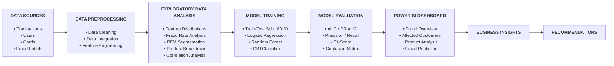

# Banking Transaction Fraud Risk Assessment

**English** | [Tiếng Việt](README.md)

---

## 1. Business Context

News headlines and television reports about wire transfer scams or stolen card credentials used for unauthorized transactions have become increasingly common. In just a few taps, funds can vanish from an account without the account holder's awareness, and recovery is rarely straightforward.

Upon discovering missing funds, customers instinctively turn to the bank for assistance. However, banks cannot always recover lost money. Such incidents not only inflict direct financial losses on customers but also erode customer confidence in the safety and security of banking services.

In response to this growing challenge, during an internal meeting on banking fraud, the **Chief Risk Officer (CRO)** shared the urgent difficulties the bank was facing and tasked me — a **Risk Analyst** — with conducting an in-depth investigation into transaction fraud:

> **"Lately, our branches and support centers have been receiving a surge of customer requests regarding transaction incidents. Some need lost cards blocked immediately, others file dispute requests for accidental transfers, and several have had their mobile banking credentials compromised. Most of the stolen funds cannot be recovered, forcing cases to be handed over to law enforcement. Each incident triggers panic, tarnishes our brand reputation, and undermines customer trust in our bank's security. Therefore, I need your help to build an intuitive dashboard illustrating the current fraud landscape and identifying which segments fraud is concentrated in, so we can get a firm grasp of the situation first."**

Based on the CRO's mandate, I broke down the project into the following key objectives:

1. Assess fraud volume and trends across time and transaction locations.
2. Identify customer profiles and behavioral patterns associated with fraud to prioritize surveillance.
3. Identify products, transaction methods, and channels with notable fraud exposure.
4. Evaluate the feasibility of predicting fraudulent transactions using risk signals and select an optimal model for forecasting.

---

## 2. Expected Deliverables

To fulfill the CRO's requirements, the reporting suite was architected into an interconnected system of 4 Dashboards following an analytical flow from diagnosing the current state to recommending actionable solutions:

| No. | Dashboard | Presentation Content | Significance |
| :---: | :--- | :--- | :--- |
| **01** | **Fraud Overview** | Visualizes the overall picture of fraud scale and trends across time, location, and transaction characteristics | Provides situational awareness on fraud, identifying critical timeframes and regions with notable risks to guide surveillance efforts |
| **02** | **Fraud – Affected Customers** | Analyzes fraud rates across RFM segments, age brackets, and customer income tiers | Identifies customer cohorts with above-average fraud rates to prioritize monitoring and design appropriate protective measures |
| **03** | **Fraud Rate by Banking Products** | Compares fraud risk across card types, card brands, transaction channels, and card usage patterns | Pinpoints products, payment methods, and channels with notable risks to consider strengthened controls |
| **04** | **Fraud Prediction Result** | Evaluates and benchmarks the fraud detection efficacy of machine learning models | Establishes an empirical basis for selecting promising candidate models to further evaluate and develop fraud detection solutions |

---

## 3. Data

### 3.1. Dataset Scale

| Metric | Scale |
| --- | ---: |
| Total Transactions | 8,914,963 |
| Customer Profiles | 2,000 |
| Card Profiles | 6,146 |
| Fraudulent Transaction Rate | 0.15% |
| Observation Window | 2010–2019 |

### 3.2. Main Data Tables and Key Features

#### `transactions_data.csv` — Transaction Records

| Column | Description |
| --- | --- |
| `id` | Unique transaction ID |
| `date` | Transaction timestamp |
| `client_id` | Customer ID |
| `card_id` | Card ID |
| `amount` | Transaction value (USD) |
| `use_chip` | Whether chip authentication was utilized |
| `merchant_id` | Merchant ID |
| `merchant_city` | Merchant city location |
| `merchant_state` | Merchant location (state) |
| `zip` | Merchant ZIP code |
| `mcc` | Merchant Category Code (industry classification) |
| `errors` | Transaction error details |

#### `users_data.csv` — Customer Demographics

| Column | Description |
| --- | --- |
| `client_id` | Unique customer ID |
| `current_age` | Current customer age |
| `retirement_age` | Expected retirement age |
| `birth_year` | Year of birth |
| `gender` | Gender |
| `latitude`, `longitude` | Customer location coordinates |
| `per_capita_income` | Per capita income |
| `yearly_income` | Annual income |
| `total_debt` | Total outstanding debt |
| `credit_score` | Credit score |
| `num_credit_cards` | Number of credit cards held |

#### `cards_data.csv` — Card Profiles

| Column | Description |
| --- | --- |
| `id` | Unique card ID |
| `client_id` | Customer ID |
| `card_brand` | Card network/brand (Visa, Mastercard, etc.) |
| `card_type` | Card type (Credit, Debit) |
| `has_chip` | Whether the card features chip technology |
| `credit_limit` | Credit limit |
| `acct_open_date` | Account opening date |
| `year_pin_last_changed` | Year of most recent PIN change |
| `card_on_dark_web` | Whether card credentials were leaked on the dark web |

#### `train_fraud_labels.json` — Fraud Ground Truth

| Column | Description |
| --- | --- |
| `id` | Unique transaction ID |
| `is_Fraud` | Fraud binary label (True/False, approximately 0.15% positive) |

---

## 4. Project Workflow

### 4.1. Data Preparation and Processing

- Inspected schema structure, data types, missing values, and duplicate records.
- Standardized transaction amounts and currency-formatted fields.
- Imputed and handled missing merchant location and transaction error details per project rules.
- Merged transaction records with customer profiles, card metadata, and fraud labels.
- Engineered granular temporal and demographic features: hour, day, month, year, age tiers, income brackets, transaction amount bins, and product attributes.

### 4.2. Exploratory Data Analysis

- **Operational scale:** Transaction volume and value tracked over time, customer segments, products, and channels.
- **Risk exposure:** Fraud rate across individual segments.
- **RFM customer segmentation:** RFM scoring groups customers across three criteria: Recency, Frequency, and Monetary value. Customer segments include: Champions, Loyal, New Customers, Potential Loyalists, Need Attention, Cannot Lose Them, and Lost Customers.
- **Product-level transaction segmentation:** Grouped transaction value, volume, unique customers, and fraud rates across card types, card brands, and transaction methods.
- **Correlation analysis:** Identified influential variables to incorporate into fraud risk prediction models.

### 4.3. Model Development and Evaluation

Three algorithms representing increasing tiers of complexity were benchmarked:

- **Logistic Regression:** Interpretable baseline model.
- **Random Forest:** Ensemble tree model capable of capturing non-linear relationships.
- **GBTClassifier:** Gradient boosted decision trees sequentially optimizing weak learners to enhance classification accuracy.

Models were evaluated across multiple metrics to reflect discrimination power, fraud detection capability, and false alert costs simultaneously.

---

## 5. Power BI Visualization & Current-State Analysis

### 5.1. Fraud Overview

The dataset records **8.91 million transactions**, **13,332 fraudulent transactions**, a baseline fraud rate of **0.15%**, and an estimated cumulative fraud loss of approximately **$1.47 million** over the 2010–2019 period.

- **Time Series Trend (2010–2019):**
  - Transaction volume grew steadily from 2010 to 2015 and stabilized from 2016 onward, indicating the bank's active customer base matured past its rapid growth phase and reached saturation.
  - The fraud rate (*Fraud Rate*) fluctuated dramatically, peaking in **2016 (0.53%)**. Risk trends reflect a ~2-year cyclical pattern: following major fraud attack waves, the risk rate cools down the following year as consumers heighten vigilance, but subsequently climbs back as fraudsters evolve more sophisticated techniques.
- **Distribution by Transaction Amount:**
  - Fraud rates surge drastically for high-value transactions, particularly those of **$2,000 and above (12.79%)**, despite representing a small fraction of transaction volume. This implies that financial severity per successful fraud incident is substantial.
- **Geographic Distribution (Merchant Location):**
  - Fraud is heavily concentrated across **North America** (especially Southeastern coastal states) and scattered across major commercial hubs in **Europe**. These mature markets exhibit dense card usage and digital payment adoption, naturally elevating risk exposure.
- **Temporal Heatmap Matrix:**
  - Fraud risk clusters heavily during daytime hours **09:00 – 16:00, with a dramatic spike on Sundays**. Concurrently, thermal hotspots emerge during late-night to early-morning hours (**03:00 – 05:00**).
  - *Behavioral Hypotheses:* Daytime fraud concentration likely stems from social engineering tactics where fraudsters exploit victims' busy work hours to fabricate urgency (impersonating officials or demanding urgent transfers). Conversely, during early morning hours, victims are asleep and slower to detect unauthorized activity. On weekends, leisure, dining, and travel activities heighten the likelihood of lost cards and compromised checkout terminals.

---

### 5.2. Fraud – Affected Customers

The analysis examines **1,219 active customers out of 2,000 total profiles**, evaluating transaction scale and fraud rates across RFM segments, age groups, transaction timing, and spend amounts.

- **RFM Segmentation:** The customer base is partitioned into 4 primary clusters: **Potential Customers** (New Customers, Potential Loyalist, Promising) comprising 42.49% of active users, followed by **VIPs** (Champions, Loyal) at 32.81%, **At-Risk Churn** (Cannot Lose Them, Lost Customers, Need Attention) at 16.65%, and **Others** at 8.04%. Notably:
  - **New Customers:** Record the highest fraud rate across the portfolio (**0.31%**, 3x higher than Champions). Potential drivers include synthetic identity fraud during account opening and unfamiliarity with digital security best practices among newly onboarded users.
  - **Lost Customers:** Display the second-highest fraud rate (**0.24%**). A substantial proportion of churn may be a direct consequence of customers suffering fraud or financial scams, subsequently losing trust in the bank's security safeguards.
- **Age Brackets:**
  - Customers aged **56 and older** represent over **40%** of active cardholders and post a fraud rate of **0.17%** (the highest among all age brackets). While representing a core banking demographic, this cohort is disproportionately targeted by cybercriminals due to lower digital literacy and vulnerability to social engineering scams.
- **Annual Income Tiers (Yearly Income):**
  - The ultra-low annual income bracket (**$100 – $1,000**) exhibits an abnormal risk spike (**0.63%**, 4–5x the system average). This segment largely consists of students and young or unbanked individuals with limited financial literacy, making them easy targets for fraud schemes.

---

### 5.3. Fraud Rate by Banking Products

This section inspects **4,070 active cards out of 6,146 total cards**, evaluating risk profiles across card types, card networks, transaction channels, and multi-card ownership.

- **Average Cards Owned per Customer:**
  - The portfolio averages **3.34 cards per active customer**. However, transaction distribution is highly skewed: over **99%** of customers actively use only 1–2 cards. The small segment holding 3 or more active cards accounts for just **0.88%** of customers but suffers the highest fraud rate (**0.19%**). Spreading transactions across multiple cards increases the risk of credential leakage and slack balance monitoring.
- **Card Type:**
  - **Debit (Prepaid)** cards comprise the smallest volume share (~8.87%) but carry the highest fraud rate in the catalog (**0.22%**). Because prepaid cards are not tied directly to primary bank accounts and historically undergo lighter KYC/verification procedures, bad actors exploit these loopholes to alter balances or cash-out limits. Furthermore, the absence of rich historical behavioral data complicates real-time anomaly detection.
- **Card Brand:**
  - **Discover** commands a small transaction share (<3%) but records the highest fraud rate (**0.21%**), surpassing Visa and Mastercard (both at 0.15%). This suggests smaller network rails may face disproportionate targeting where security controls and real-time fraud scoring are less aggressively tuned compared to dominant global networks.
- **Transaction Channel:**
  - Online transactions exhibit the highest fraud vulnerability, reaching **0.84%** — 8x higher than Chip (**0.10%**) and 28x higher than Swipe (**0.03%**), despite accounting for only **11.7%** of total transactions. Online channels remain prime vectors for phishing sites, social engineering, or data leaks, enabling fraudsters to transact remotely without physical card possession.

---

## 6. Fraud Prediction Model Results

The exploratory analysis established **where fraud occurs and which risk factors correlate with it**. The next critical milestone was to test:

> **Do these features possess sufficient discriminative power to differentiate fraud from non-fraud transactions and generate reliable risk assessment signals?**

Data processing, feature engineering, model training, and evaluation were executed in [`banking_transaction_analytics.ipynb`](banking_transaction_analytics.ipynb). The Power BI "Fraud Prediction Result" view synthesizes these technical results into an executive governance format, highlighting true fraud capture against missed frauds and false alerts.

### Performance Comparison

| Model | ROC-AUC | PR-AUC | Accuracy | Precision | Recall | F1-score |
| --- | ---: | ---: | ---: | ---: | ---: | ---: |
| Logistic Regression | 0.8444 | 0.0213 | 99.85% | 28.97% | 0.29% | 0.58% |
| Random Forest | 0.8934 | 0.0927 | 99.85% | **98.91%** | 2.56% | 5.00% |
| **GBTClassifier** | **0.9427** | **0.2748** | **99.87%** | 94.54% | **11.42%** | **20.38%** |

### Fraud Detection Capability

| Model | Fraud Correctly Detected (TP) | Fraud Missed (FN) | False Alerts (FP) | Total Fraud in Evaluation Set |
| --- | ---: | ---: | ---: | ---: |
| Logistic Regression | 31 | 10,581 | 76 | 10,612 |
| Random Forest | 272 | 10,340 | **3** | 10,612 |
| **GBTClassifier** | **1,212** | **9,400** | 70 | 10,612 |

**GBTClassifier emerges as the superior candidate model within the project scope**, securing the highest ROC-AUC and PR-AUC, while capturing the highest volume of fraudulent transactions at default threshold settings.

However, a Recall of **11.42%** indicates that the model still misses the vast majority of fraud. Consequently, the model is best suited as an **early warning / alert generation signal** rather than a standalone automated transaction-blocking signal.

---

## 7. Data-Driven Recommendations

### Monitoring Anomalous Transactions

- Mandate step-up verification for transactions that deviate significantly from a customer's historical average ticket size.
- Tighten surveillance during high-risk time windows and days, monitoring sudden transaction velocity and abnormal balance fluctuations.
- Trigger enhanced verification when transactions originate from locations disparate from the customer's habitual spending pattern.

### Strengthening Customer Protection

- Enhance KYC and identity verification protocols for newly registered accounts to mitigate synthetic identity fraud, accompanied by onboarding guides on account security.
- Regularly broadcast fraud alert notifications and scam advisories, tailored specifically to elderly cardholders.

### Product & Channel Risk Controls

- Introduce additional authentication steps for suspicious Online transactions.
- Re-audit security policies governing Debit (Prepaid) and Discover cards to identify procedural vulnerabilities, thereby implementing additional safeguards or verification steps.
- Encourage cardholders to lock dormant or rarely used cards to eliminate idle attack surfaces and curb unauthorized charges.

### Machine Learning in Fraud Detection

- Leverage machine learning models to support early detection and flagging of suspicious transactions. As more data is gathered and training pipelines are refined, models can be progressively upgraded to boost detection accuracy and empower proactive risk governance.

---

## 8. Personal Value Delivered & Key Competencies

Mastered the mindset and sequential end-to-end reporting implementation workflow:

- Acquired the ability to identify core business questions, objectives, expected deliverables, and required data sources to solve a business problem.
- Utilized PySpark on Databricks to process large-scale data with nearly 10 million records; built, evaluated, and compared Machine Learning models for fraud prediction on highly imbalanced data.
- Connected and modeled data in Power BI, created essential analytical metrics (DAX Measures), and designed interactive visualizations to support insight discovery, pinpoint issues, and derive actionable insights from reports.
- Enhanced domain understanding of banking operations, particularly in risk management, gaining practical insight into how a Risk Analyst leverages data to support everyday risk governance.
