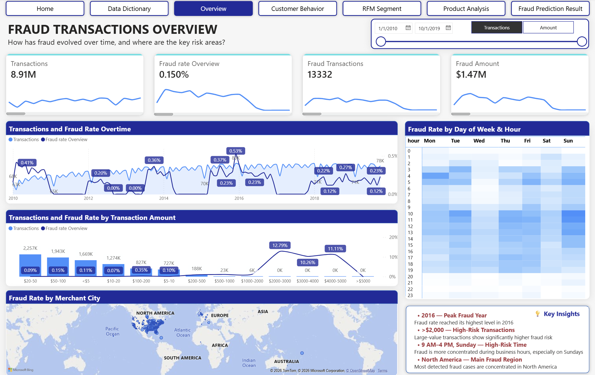
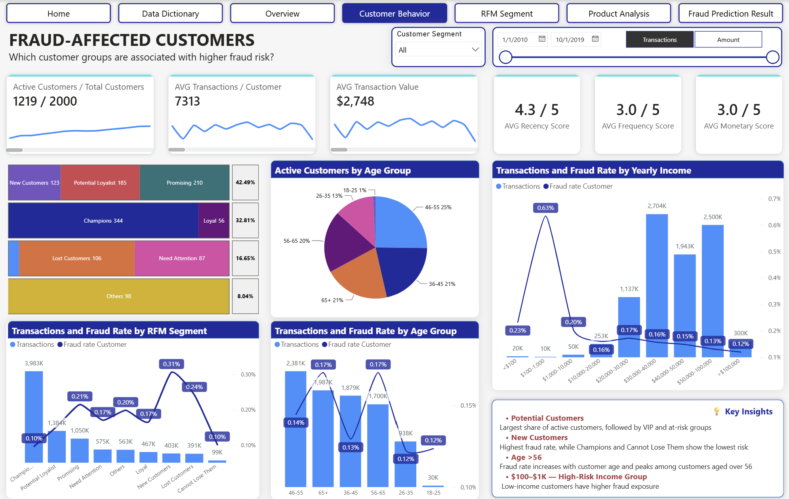
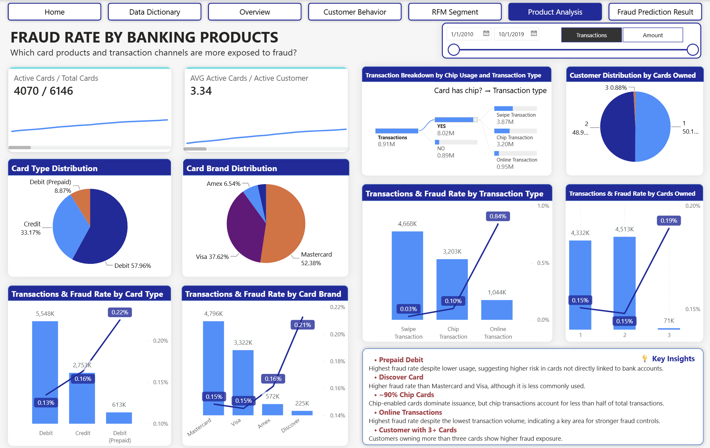
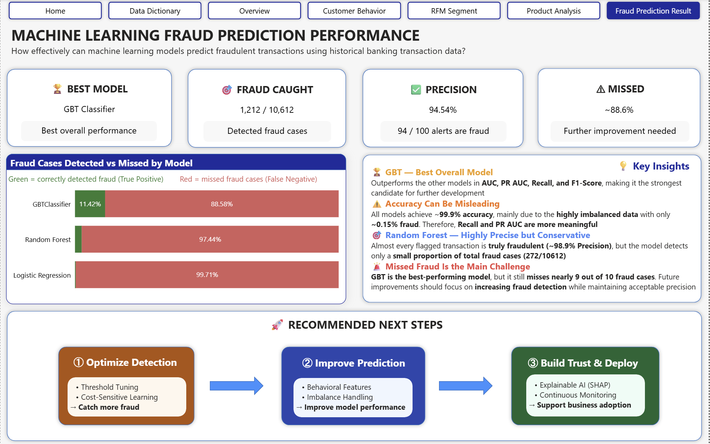

# Banking Transaction Fraud Risk Assessment

**English** | [Tiếng Việt](README.md)

---

## 1. Business Context

Digital transformation is reshaping how banks deliver products and execute transactions. As the customer base expands, digital transaction channels become ubiquitous, and banks continuously introduce new payment products and methods to enhance convenience, speed, and security for customers.

However, alongside this growth, **the risk surface is also shifting**. While newer methods and technologies may be safer and more efficient than legacy ones, vulnerabilities may still emerge that fraudsters can exploit.

In practice, several fraud incidents have been recorded during operations, impacting customers and harming the bank's reputation. Furthermore, the bank must dedicate substantial resources to investigate, handle, and remediate arising issues.

This poses two key requirements for risk management:

- **Identify where fraud frequently occurs** to concentrate monitoring efforts on transactions, customer segments, products, or channels exhibiting higher risk signals.
- **Improve predictive capabilities** when existing risk partitioning and assessment methods fail to keep pace with changing transaction behaviors and evolving technology.

Against this backdrop, the **Chief Risk Officer (CRO)** seeks to understand:

> **What is the current state of banking transaction fraud, where is fraud concentrated, which factors correlate with fraud risk, and can these signals be leveraged to proactively assess the risk of each transaction?**

To address the Chief Risk Officer's inquiry, the project focuses on the following objectives:

1. Assess fraud scale and trends over time, across locations, and by transaction characteristics.
2. Identify customer characteristics and behaviors associated with fraud to prioritize monitoring.
3. Identify products, transaction methods, and channels with notable fraud exposure.
4. Evaluate the feasibility of predicting fraudulent transactions from risk signals and select an appropriate model for prediction.

The ultimate goal is to transition from:

> **Knowing where fraud occurred → knowing where to prioritize monitoring → evaluating the capability for earlier risk detection.**

---

## 2. Expected Outcomes

| CRO's Question | Deliverables & Presentation |
| --- | --- |
| **How is fraud occurring?** | Scale, rate, trends, and key patterns |
| **Where is fraud concentrated?** | Risk breakdown across time, location, customer profiles, and transactions |
| **Which customer groups require closer attention?** | Customer Behavior and RFM Segmentation |
| **Which products/channels are noteworthy?** | Product Analysis |
| **Can fraud risk be predicted?** | Prediction results from Machine Learning models |
| **Which model is more suitable?** | Comparative analysis of detection capability, false alerts, and operational applicability |

### Power BI Report Pages

**01 — Fraud Overview**  
Answers: *Where and when is fraud occurring?*

**02 — Customer Behavior**  
Answers: *Which customer characteristics and behaviors warrant attention?*

**03 — RFM Segment**  
Answers: *Where does fraud exposure lie across customer segments?*

**04 — Product Analysis**  
Answers: *Which products and transaction methods need closer monitoring?*

**05 — Fraud Prediction Result**  
Answers: *Can data be leveraged to generate transaction risk evaluation signals?*

---

## 3. Data

### 3.1. Dataset Scale

| Metric | Scale |
| --- | ---: |
| Number of transactions | 8,914,963 |
| Customer records | 2,000 |
| Card records | 6,146 |
| Fraud transaction rate | 0.15% |
| Observation period | 2010–2019 |

### 3.2. Main Data Tables and Key Features

#### `transactions_data.csv` — Transaction Data

| Column | Description |
| --- | --- |
| `id` | Transaction identifier |
| `date` | Transaction timestamp |
| `client_id` | Customer identifier |
| `card_id` | Card identifier |
| `amount` | Transaction amount (USD) |
| `use_chip` | Whether the transaction used chip authentication |
| `merchant_id` | Merchant identifier |
| `merchant_city` | Merchant location (city) |
| `merchant_state` | Merchant location (state) |
| `zip` | Merchant ZIP code |
| `mcc` | Merchant Category Code (business type) |
| `errors` | Transaction error details |

#### `users_data.csv` — Customer Data

| Column | Description |
| --- | --- |
| `client_id` | Customer identifier |
| `current_age` | Current customer age |
| `retirement_age` | Expected retirement age |
| `birth_year` | Year of birth |
| `gender` | Gender |
| `latitude`, `longitude` | Customer location coordinates |
| `per_capita_income` | Per capita income |
| `yearly_income` | Annual income |
| `total_debt` | Total outstanding debt |
| `credit_score` | Credit score |
| `num_credit_cards` | Number of credit cards owned |

#### `cards_data.csv` — Card Data

| Column | Description |
| --- | --- |
| `id` | Card identifier |
| `client_id` | Customer identifier |
| `card_brand` | Card brand (Visa, Mastercard, etc.) |
| `card_type` | Card type (Credit, Debit) |
| `has_chip` | Whether the card features chip technology |
| `credit_limit` | Credit limit |
| `acct_open_date` | Account opening date |
| `year_pin_last_changed` | Year of most recent PIN change |
| `card_on_dark_web` | Whether card credentials were leaked on the dark web |

#### `train_fraud_labels.csv` — Fraud Labels

| Column | Description |
| --- | --- |
| `id` | Transaction identifier |
| `is_Fraud` | Fraud label (True/False, approximately 0.15% positive) |

---

## 4. Project Workflow

### 4.1. Data Preparation and Processing

- Inspect data structure, data types, missing values, and duplicate records.
- Standardize transaction amounts and currency-formatted fields.
- Impute and handle missing merchant location and transaction error details per project business rules.
- Merge transaction records with customer profiles, card data, and fraud labels.
- Engineer features for hour, day of week, month, year, age brackets, income tiers, transaction amount bins, and product attributes.

### 4.2. Exploratory Data Analysis

- **Operational scale:** transaction volume and value over time, by customer, product, and channel.
- **Risk exposure:** fraud rate across individual segments.
- **RFM customer segmentation:** RFM scoring groups customers across three criteria: Recency, Frequency, and Monetary value. Customer segments include: Champions, Loyal, New Customers, Potential Loyalists, Need Attention, Cannot Lose Them, and Lost Customers.
- **Product-level transaction segmentation:** transaction value, volume, and customer count by product across card types, card brands, and transaction methods.
- **Correlation analysis:** identify key influential variables for integration into the fraud risk prediction models.

### 4.3. Model Development and Evaluation

Three models representing varying tiers of complexity were chosen:

- **Logistic Regression:** interpretable baseline model.
- **Random Forest:** ensemble tree model capable of capturing non-linear relationships.
- **GBTClassifier:** gradient boosted decision tree model sequentially optimizing trees to enhance classification accuracy.

Models are evaluated across multiple metrics to assess discriminatory power, fraud detection capability, and false alert costs simultaneously.
---

# 5. Current-State Analysis

## 5.1. Fraud Overview

The Overview dashboard records **8.91 million transactions**, **13,332 fraudulent transactions**, a fraud rate of **0.15%**, and a total fraud loss of approximately **$1.47 million** over the 2010–2019 period.

Key findings:

- Transaction volume trended upwards in the initial years and remained relatively stable thereafter; the fraud rate fluctuated more dramatically, peaking in **2016** (0.53%).
- Fraud rates surge noticeably for high-value transactions, particularly those of **$2,000 and above** (12.79%).
- Fraud is predominantly concentrated during **09:00–16:00**, particularly on Sundays.
- The majority of fraud cases were recorded in the **North America** region.

**Recommendation:** The bank should prioritize monitoring high-value transactions and time windows with elevated fraud concentration. These signals should be combined with customer profiles, product types, and channels rather than used as standalone decline criteria.

---

## 5.2. Customer Behavior

The Customer Behavior dashboard analyzes **1,219 active customers out of 2,000 total customers**, examining transaction scale and fraud rates across RFM segments, age groups, time periods, and transaction values.

Key findings:

- The potential customer group (New Customers, Potential Loyalist, Promising) accounts for **42.49%** of active customers, followed by VIPs (Champions, Loyal) at **32.81%**, at-risk churn customers (Cannot Lose Them, Lost Customers, Need Attention) at **16.65%**, and other segments (Others) at **8.04%**.
- **New Customers** exhibit the highest fraud rate among RFM segments at approximately **0.31%**; Champions and Cannot Lose Them show the lowest at approximately **0.10%**.
- Customers aged **56 and older** show a fraud rate of approximately **0.17%**, higher than several younger age groups.
- The **$100–1,000** annual income bracket records the highest risk level **(0.63%)** compared to other income groups in the observed data.

**Recommendation:** New customers should undergo enhanced monitoring during the initial stages of the customer relationship. Age, income, or RFM segments should serve as supplementary signals within a multi-factor risk assessment mechanism.

---

## 5.3. Product Analysis

The Product Analysis dashboard analyzes **4,070 active cards out of 6,146 total cards**, evaluating risk by card type, card brand, transaction method, and number of cards owned.

Key findings:

- Debit cards account for the largest portfolio share, followed by Credit and Debit (Prepaid).
- Debit (Prepaid) carries the highest fraud rate among card types at approximately **0.22%**.
- Mastercard is the most utilized card brand, followed by Visa, Amex, and Discover.
- Discover has the highest fraud rate among card brands at approximately **0.21%**.
- Online transactions carry a fraud rate of **0.84%**, significantly higher than Chip (**0.10%**) and Swipe (**0.03%**), despite having the lowest transaction volume among the three methods.
- Customers holding three cards have a fraud rate of approximately **0.19%**, higher than those holding one or two cards.

**Recommendation:** Online transactions, prepaid cards, and higher-risk card brands should be prioritized when designing rules and step-up authentication. Control decisions must weigh both fraud rate and transaction volume for each segment.

---

# 6. Fraud Prediction Model Results

The current-state analysis helped identify **where fraud occurs and what factors correlate with it**. The next step is to examine:

> **Do these features possess sufficient discriminative power between fraud and non-fraud transactions to generate risk assessment signals?**

Data processing, feature engineering, model training, and evaluation are conducted in [`banking_transaction_analytics.ipynb`](banking_transaction_analytics.ipynb) using Python with the PySpark ML library. The Fraud Prediction Result page in Power BI synthesizes the notebook outputs into an executive risk perspective, highlighting true fraud detection capability versus missed fraud cases.

### Performance Comparison

| Model | ROC-AUC | PR-AUC | Accuracy | Precision | Recall | F1-score |
| --- | ---: | ---: | ---: | ---: | ---: | ---: |
| Logistic Regression | 0.8444 | 0.0213 | 99.85% | 28.97% | 0.29% | 0.58% |
| Random Forest | 0.8934 | 0.0927 | 99.85% | **98.91%** | 2.56% | 5.00% |
| **GBTClassifier** | **0.9427** | **0.2748** | **99.87%** | 94.54% | **11.42%** | **20.38%** |

### Fraud Detection Capability

| Model | Fraud Correctly Detected (TP) | Fraud Missed (FN) | False Alerts (FP) | Total Fraud in Evaluation Set |
| --- | ---: | ---: | ---: | ---: |
| Logistic Regression | 31 | 10,581 | 76 | 10,612 |
| Random Forest | 272 | 10,340 | **3** | 10,612 |
| **GBTClassifier** | **1,212** | **9,400** | 70 | 10,612 |

**GBTClassifier is the best candidate model within the project scope**, achieving the highest ROC-AUC and PR-AUC, while capturing the most fraud cases at the default threshold.

However, a Recall of **11.42%** indicates that the model still misses the vast majority of fraud. Therefore, the model is best suited as a **warning/alert generation signal** rather than a standalone automated transaction-blocking signal.

---

# 7. Recommendations

The findings translate into three monitoring recommendation pillars:

### 01 — Transaction Monitoring
Enhance monitoring on high-value transactions, Online transactions, and time windows with notable fraud exposure.

### 02 — High-Risk Customer Segment Monitoring
Monitor new customers more closely and integrate behavior, profile attributes, and RFM scores as complementary signals in a multi-factor risk assessment framework.

### 03 — Monitoring Customers Using Less Common Products
Products and transaction methods such as Debit (Prepaid) cards, Discover cards, Online transactions, and customers holding 3 or more cards represent a smaller transaction share, yet carry substantially higher fraud risk compared to mainstream segments.

---

# 8. Personal Gain Value 

Mastering end-to-end analytical thinking and reporting workflow:

- Identified business questions, objectives, expected deliverables, and required data sources to solve a business problem.
- Utilized PySpark on Databricks to process large-scale data with nearly 10 million records; trained, evaluated, and compared Machine Learning models on highly imbalanced fraud data.
- Connected and modeled data in Power BI, created essential analytical metrics, and designed interactive visualizations to support insight discovery and reporting.
- Gained practical banking domain knowledge, particularly in risk management, understanding how a Risk Analyst approaches data to support daily risk governance.
